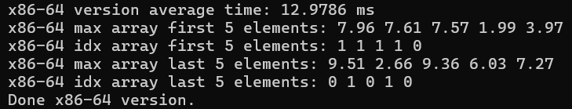
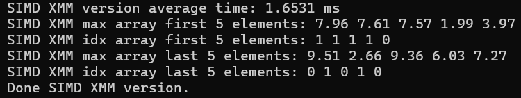
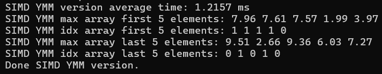
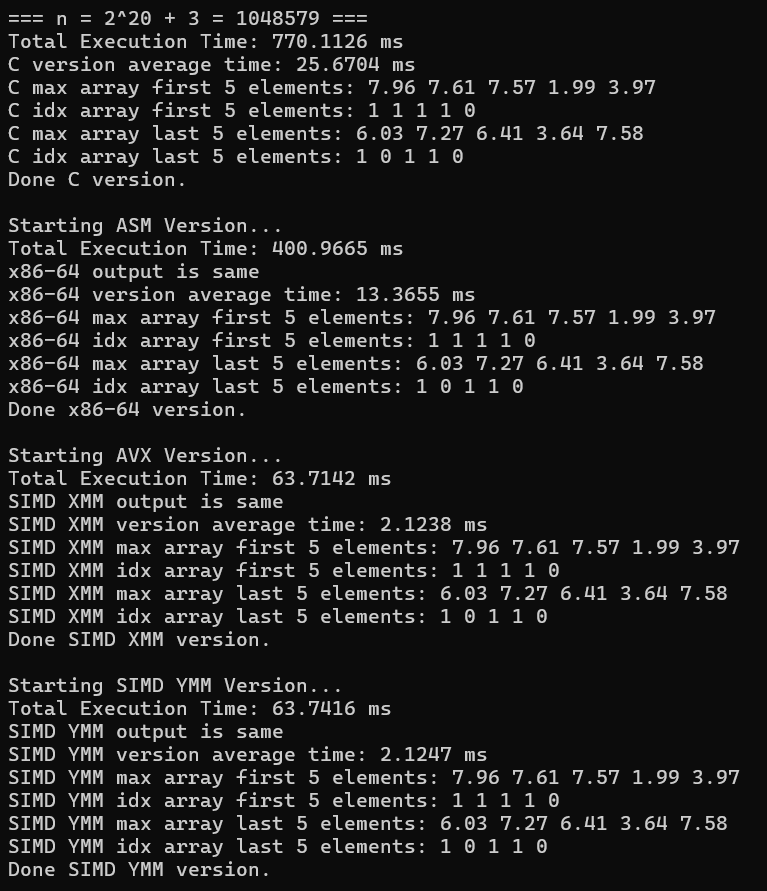
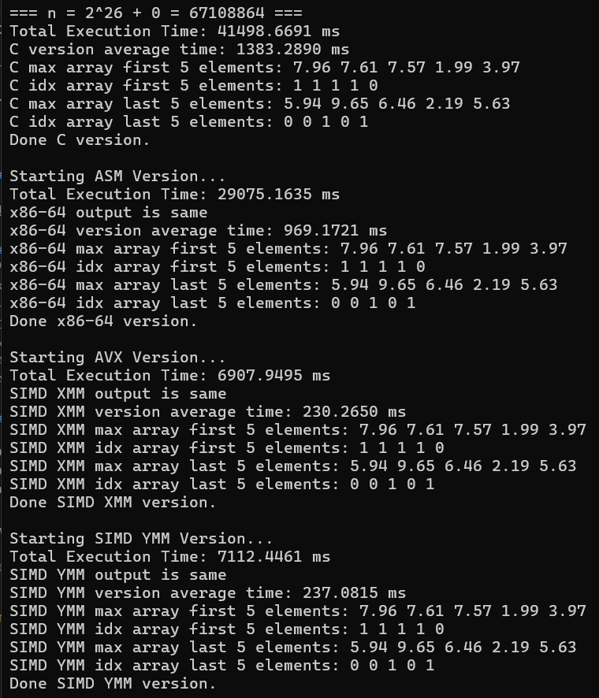

# CSC612M - SIMD Programming

**Group 4 | G01**

## Group Members
- AGUARIN, Trish Ann Danielle C.
- ANDAYA, Kurt Christian D.
- CABATO, Marxandrea Diane G.

---

## 1. Program Output and Execution Time

### Program Output (Debug)

#### $2^{20}+0$ Print Output (Debug)


#### $2^{20}+3$ Print Output


#### $2^{26}+0$ Print Output


#### $2^{28}+0$ Print Output


### Program Output (Release)

#### $2^{20}+0$ Print Output (Release)


#### $2^{20}+3$ Print Output (Release)


#### $2^{26}+0$ Print Output (Release)


#### $2^{28}+0$ Print Output (Release)


### Comparative Execution Time (in ms)

*Note: This is without offset*

| Kernel | $2^{20}$ debug | $2^{20}$ release | $2^{26}$ debug | $2^{26}$ release | $2^{28}$ debug | $2^{28}$ release |
| --- | --- | --- | --- | --- | --- | --- |
| **C** | 12.1335 | 1.5148 | 781.0648 | 85.7272 | 4432.4441 | 389.7474 |
| **x86-64** | 6.2339 | 6.3444 | 427.1414 | 408.2685 | 1841.2770 | 1671.7546 |
| **XMM** | 0.7305 | 1.0435 | 58.5030 | 59.1313 | 230.3797 | 225.4137 |
| **YMM** | 0.8657 | 0.7269 | 62.5469 | 54.0027 | 245.7155 | 220.0916 |

### Performance Speedup Analysis

| Kernel | $2^{20}$ debug | $2^{20}$ release | $2^{26}$ debug | $2^{26}$ release | $2^{28}$ debug | $2^{28}$ release |
| :--- | :--- | :--- | :--- | :--- | :--- | :--- |
| **C** | 1.00x | 1.00x | 1.00x | 1.00x | 1.00x | 1.00x |
| **x86-64** | 1.95x | 0.24x | 1.83x | 0.21x | 2.41x | 0.23x |
| **XMM** | 16.61x | 1.45x | 13.35x | 1.45x | 19.24x | 1.73x |
| **YMM** | 14.02x | 2.08x | 12.49x | 1.59x | 18.04x | 1.77x |

#### Debug Build Speedups

**a. x86-64 Assembly:** How many times faster is it than C?

* $2^{20}$: 1.946 $\times$
* $2^{26}$: 16.609 $\times$
* $2^{28}$: 2.407 $\times$

**b. AVX (XMM):** How many times faster is it than C?

* $2^{20}$: 16.610 $\times$
* $2^{26}$: 13.351 $\times$
* $2^{28}$: 19.240 $\times$

**c. AVX2 (YMM):** How many times faster is it than C?

* $2^{20}$: 14.016 $\times$
* $2^{26}$: 12.488 $\times$
* $2^{28}$: 18.039 $\times$

---

#### Release Build Speedups

**a. x86-64 Assembly:** How many times faster is it than C?

* $2^{20}$: 0.239 $\times$ *(slower than C)*
* $2^{26}$: 0.210 $\times$ *(slower than C)*
* $2^{28}$: 0.233 $\times$ *(slower than C)*

**b. AVX (XMM):** How many times faster is it than C?

* $2^{20}$: 1.452 $\times$
* $2^{26}$: 1.450 $\times$
* $2^{28}$: 1.729 $\times$

**c. AVX2 (YMM):** How many times faster is it than C?

* $2^{20}$: 2.084 $\times$
* $2^{26}$: 1.587 $\times$
* $2^{28}$: 1.771 $\times$


**Why are the optimized implementations faster?**

The optimized implementations are faster because they reduce the amount of work that the CPU performs for each data element and leverages the processor's hardware capabilities. 

Assembly-level optimization has fewer instructions and better register usage, allowing the CPU to perform tasks with less overhead. Meanwhile, SIMD instructions enable parallel processing of multiple data elements in a single instruction. AVX (XMM) and AVX2 (YMM) further improve performance by processing multiple elements at once, with YMM registers holding twice as many elements as XMM registers.

However, the actual speedup still depends on factors such as memory bandwidth, CPU architecture, and the type of operations performed.

---

## 2. Correctness Verification

### 2.1 C Version


### 2.2 x86-64 Assembly



### 2.3 AVX (XMM)



### 2.4 AVX2 (YMM)



---

## 3. SIMD Boundary Checking (AVX (XMM) and AVX2 (YMM))


#### Code snippets for the boundary checking:

```
    mov     r10, [rsp+40]               ; idx
    xor     r11, r11                    ; r11 = byte offset 
    mov     eax, ecx                    ; eax = n
    shr     ecx, 3 ; or 2               ; ecx = n / 8 
    test    ecx, ecx
    jz      tail                     ; n < 8 -> scalar tail only

    ...

    tail:
        mov     ecx, eax
        and     ecx, 7 ;or 3           ; remainder = n % 8 or % 4
        jz      ym_done

    tail_loop:
        movss   xmm0, dword [rdx+r11]
        movss   xmm1, dword [r8+r11]
        comiss  xmm0, xmm1                  
        jb      take_b

        mov     dword [r10+r11], 0      ; store 0 in idxArray   
        movss   dword [r9+r11], xmm0    ; store 1st array's element in maxArray
        jmp     tail_next

    take_b:
        mov     dword [r10+r11], 1      ; store 1 in idxArray    
        movss   dword [r9+r11], xmm1    ; store 2nd array's element in maxArray

    tail_next:
        add     r11, 4
        dec     ecx
        jnz     tail_loop

    done:
        ret
```

Our implementation of boundary handling involves taking the remainder and storing it. A special case is done if the original number is less than the number of single precision in the register, the porgram automatically jumps to the tail subsection. The tail subsection iterates over the remainder to operate the rest of the array to obtain the max element and the index.

---

## 4. Discussion

### 4.1 Which Implementation Is the Fastest?

The fastest implementation is with the AVX and AVX2 setup, as it was up to 19x and 18x faster than the standard C (scalar) baseline in debug respectively while being at most 1.7x and 2x faster in release versions.

The possible reasons why it is the fastest among the kernels is because of its capability of holding and manipulating larger amounts of data two times better than XMM due to its capacity of 256 bits. It also leverages on the SIMD architecture to perform the operation in a quicker pace than C which performs the calculations “one by one” in a sequential phase, and not parallel.

### 4.2 Why Is the Speedup Different from Theoretical Expectations?

Based on the results of the runs we have, the results did not show the theoretical effect that YMM should be twice as faster to XMM given that YMM was slower than XMM for debug versions of all array sizes, but was almost the same time or faster in release versions. We also tried doing multiple runs to check this effect and it held true for most of the runs. 

In the release version of ${2^{20}}$, AVX2 outperforms all kernels, and this can be attributed due to this array size fitting comfortably in 4 MB, however, moving to $2^{26}$ and $2^{28}$, the memory drastically increases reaching over a gigabyte. The system could not supply data fast enough to keep the 256-bit vector execution going. With this, performance becomes memory-bound than compute-bound.

Moreover, we also noticed that during the multiple runs, there were instances that XMM was a little faster than YMM from merely milliseconds to a few seconds apart (see figures below). This discrepancy can be due to runtime environmental factors such as OS context switching, thread preemption, or differing hardware specifications. 


#### $2^{20}+3$ instance where XMM is faster 


#### $2^{26}$ instance where XMM is faster 


### 4.3 Problems Encountered and Solutions

1. $2^{30}$ restriction
>When running the program, we encountered issues when the vector size is $2^{30}$. We had to reduce it to $2^{28}$ because that is the vector size where it successfully ran in our devices. The probable cause was due to the memory capability of our respective machines. 

2. QueryPerformanceCounter instead of clock() 
>From a previous feedback, we decided to replace clock() function with QuearyPerformanceCounter (QPC) instead. QPC uses a high-resolution performance counter which lets you measure small time differemce more precisely, which is important when comparing implementations on SIMD-optimized versions where differences may be miniscule.


### 4.4 Unique Methodology Used

1. **Seeded Random Numbers**: To ensure deterministic values for array 0 and array 1, we implimented a random number generator seeded at `seed = 20` which generates the same numbers across runs. These values can also be stored in text files through the `util/document_values.c` program.

2.  **Shift for Div, And for Remainder**:  `shr` is used to divide the number while the original is stored and an `and` is used to the the dividend minus 1 to get the remainder.  

3. **Generating and using a Mask**: `vcmpps` is used to compare the vector of single precision values to generate a bit mask which is then used to choose between two arrays through `vblendvps`.

### 4.5 AHA Moments and Key Learnings

1. One consistent pattern seen in the speedup data is that raw assembly underperforms C when it comes to release versions, this may be because of the compile optimization done in VS to make C much more efficient in release compared to when it is run in debug where it is optimized for development.

2. Moreover, a minor mistake that flew under the radar was the initialization of `zero_dd` and `one_dd`to a float which caused the index array to show values that are incorrect due to the wrong initialization of the array. Data types matter in this regard when getting assigned to the registers, especially for float or integer. This is because the float types get read differently in hex value than as an integer, which triggers the “not same” flag. 

3. Initially, the program re-initializes all arrays upon switching to a different array size. The issue becomes the extensive re-use of memory, which is why, midway implementation, we decided to forego allocation and initialization for each array size and allocate to the largest array size before initializing the values for array 0 and array 1.  

4. In theory, YMM SIMD implementation should be the fastest, however in practicality, it shows little improvement and sometimes even underperform XMM SIMD. This made us realize that YMM, although may be handling multiple data, will not automatically outperform XMM, and does not automatically mean better performance. It still depends on the CPU microarchitecture, instruction type, workload, and surrounding code.


